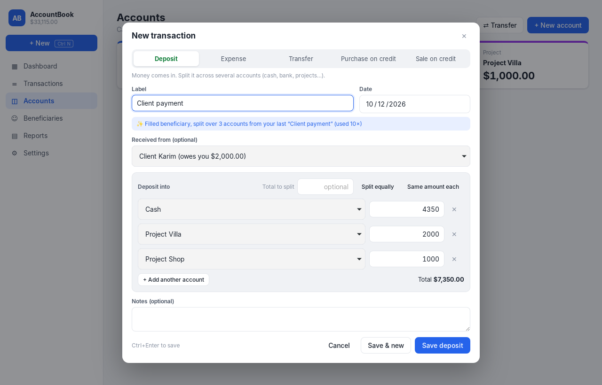
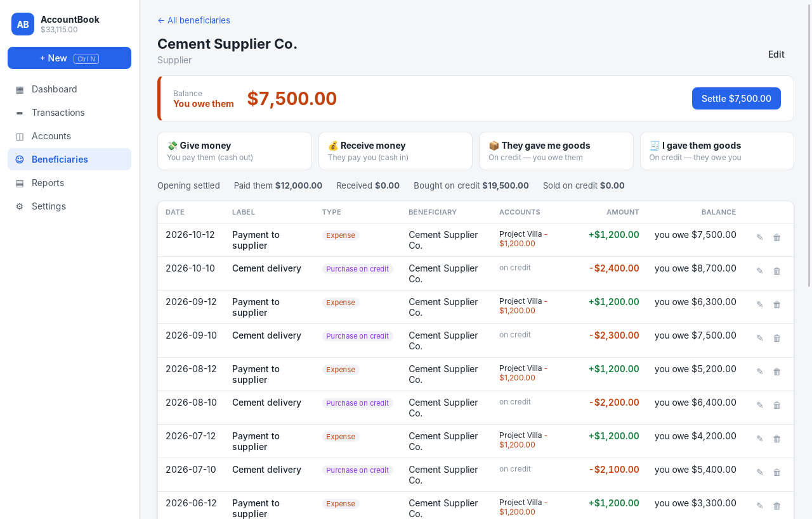
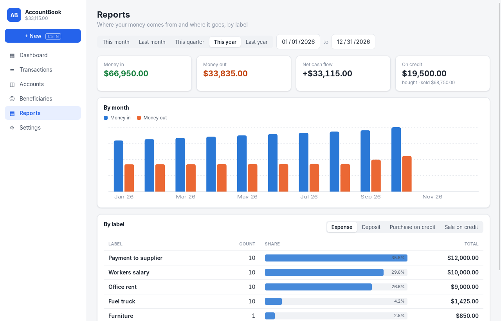

# AccountBook

A smart desktop accounting app built with **Tauri 2** (Rust backend + SQLite) and a **React + TypeScript** frontend.


## Features

- **Accounts.** Cash boxes, bank accounts and projects, each with a live balance and a statement with running balance.
- **Deposits to several accounts at once.** One deposit can be split over Cash, Project A, Project B and so on. Use *Split equally*, *Same amount each*, or type each amount yourself. A *Total to split* field shows what is left to assign.
- **Beneficiaries (suppliers, clients, people).** Every beneficiary shows **how much they owe you or how much you owe them**, with a full statement:
  - *Give money* or *Receive money* move cash and update the balance.
  - *They gave me goods (purchase on credit)* means you owe them.
  - *I gave them goods (sale on credit)* means they owe you.
  - A one-click **Settle** button.
- **Smart labels that learn from you.** As you type a label, the app suggests labels you used before. It ranks them by:
  - text match: prefix, word start, *typos* ("furnitre" finds "Furniture"), and fuzzy matching
  - how **often** and how **recently** you used each label
  - **context**: the type you are entering and the beneficiary you selected

  Picking a suggestion **auto-fills** the type, the beneficiary, the amount and even the multi-account split from the last time you used it. `Tab` accepts the grey inline completion. Settings → *Smart labels* shows what the app learned and lets you forget items.
- **Transfers** between your own accounts (one source to one or more destinations).
- **Calculator in amount fields.** Type `1200+350` or `3*45.5`.
- **Reports.** Money in and out per month, and totals per label for any period.
- **Export to CSV** (opens in Excel, UTF-8 safe for Arabic/French) and **one-click database backup** to `Documents/AccountBook`.
- Light and dark mode. Keyboard first: `Ctrl+N` creates a new transaction and `Ctrl+Enter` saves it.

| Smart suggestions | Learned multi-account deposit |
|---|---|
|  |  |

| Beneficiary statement | Reports |
|---|---|
|  |  |

## Run it

Prerequisites: [Rust](https://rustup.rs), Node.js 20+, and the [Tauri system dependencies](https://v2.tauri.app/start/prerequisites/) for your OS (WebView2 on Windows, which is already installed on Windows 10/11; webkit2gtk on Linux).

```bash
npm install
npm run tauri dev      # development window with hot reload
npm run tauri build    # installer in src-tauri/target/release/bundle/
```

Run the backend tests with `cd src-tauri && cargo test`.

Your data is stored in a single SQLite file in the OS app-data folder, for example `%APPDATA%\com.accountbook.desktop\accountbook.db` on Windows.

## How balances work

Amounts are stored as integer cents, so there are no rounding errors.

| Type | Accounts | Beneficiary balance (+ = they owe you) |
|---|---|---|
| Deposit (income) | + into each chosen account | − (they paid you) |
| Expense | − from each chosen account | + (you paid them) |
| Transfer | − source, + destinations | — |
| Purchase on credit | no money moves | − (you owe them) |
| Sale on credit | no money moves | + (they owe you) |

## Project structure

```
src-tauri/src/
  lib.rs       Tauri commands (the API used by the UI)
  ledger.rs    SQLite schema, accounts, beneficiaries, transactions, reports, learning (+ tests)
  suggest.rs   Smart-label ranking engine: fuzzy/typo match, frecency, context (+ tests)
  models.rs    Shared data types
src/
  components/LabelInput.tsx       The smart label field
  components/TransactionForm.tsx  Deposit/expense/transfer/credit form with multi-account split
  pages/                          Dashboard, Transactions, Accounts, Beneficiaries, Reports, Settings
```
