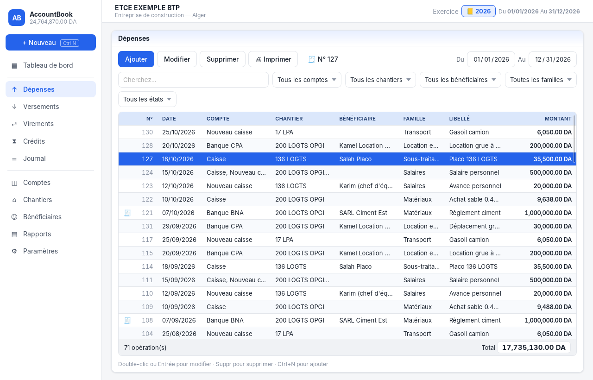
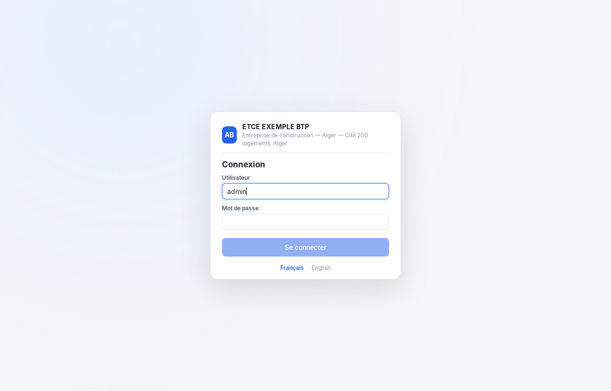
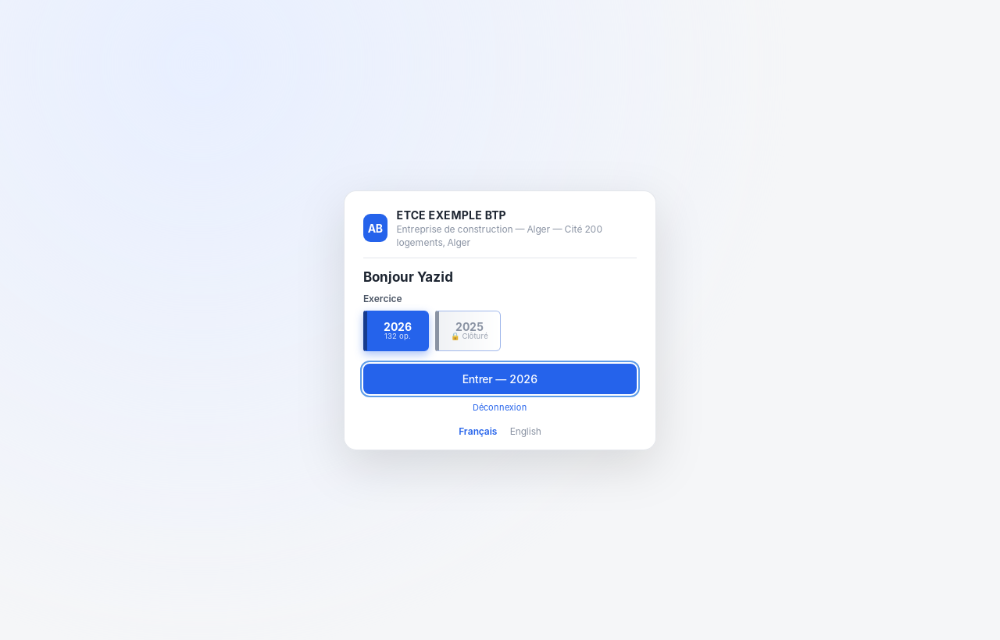
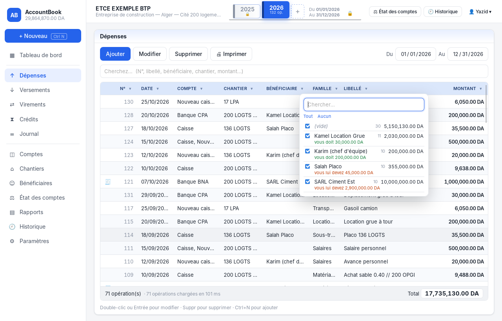
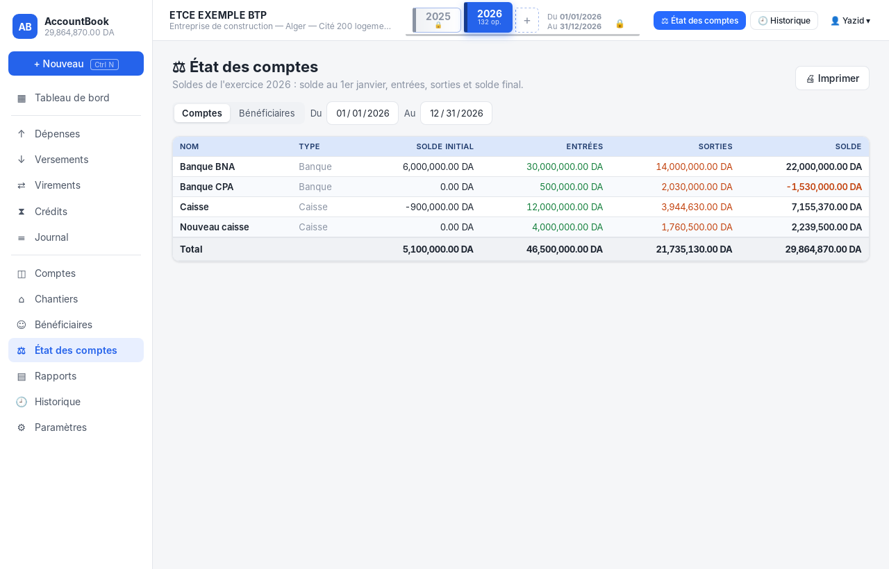
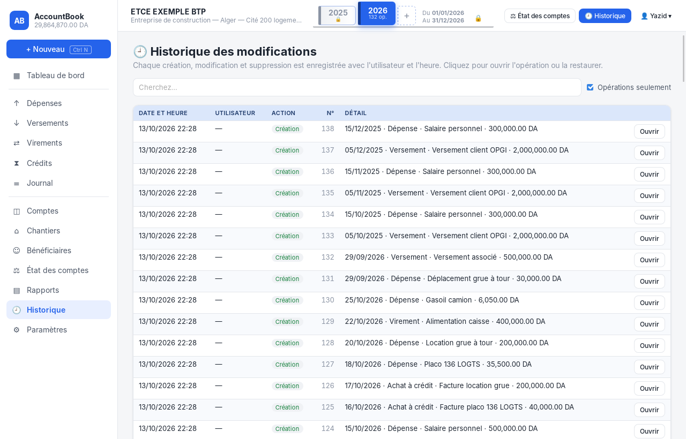
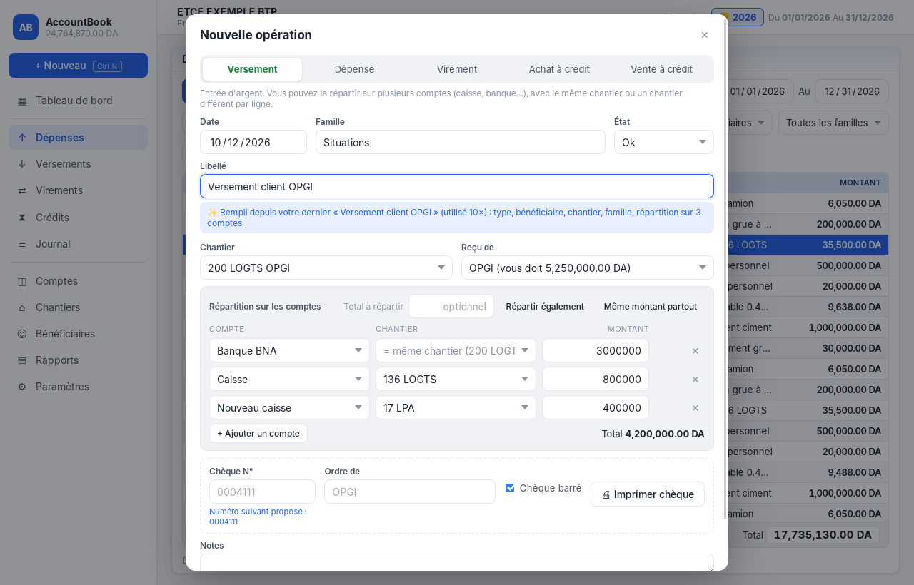

# AccountBook — gestion de trésorerie

A smart desktop treasury app for construction companies, built with **Tauri 2** (Rust + SQLite) and **React + TypeScript**.
It follows the workflow of classic treasury software (Dépenses / Versements windows, N° · Date · Compte · Chantier · Bénéficiaire · Libellé · Montant grid, fiscal years), and adds smart features on top.
The interface is in **French** by default, and English is available in Paramètres.



## Features

- **Login and users.** On first start you create the administrator. After that, a small login screen asks for the username and password, then you choose the **exercice**. There are three roles: *Administrateur* (everything), *Saisie* (data entry) and *Consultation* (read only). Passwords are hashed with Argon2, and every command is checked on the Rust side.
- **Exercices (fiscal years) in the top bar.** Each year is a book on a shelf. Selecting a year sets the whole app to 1 January to 31 December of that year. **+** creates a new exercice. 🔒 **closes** it (*clôture*): its entries become read-only until an administrator reopens it.
- **Journal windows** for Dépenses, Versements, Virements, Crédits and the full Journal:
  - a numbered grid with a total at the bottom, Du / Au dates and Ajouter / Modifier / Supprimer / Imprimer
  - a **▾ filter on every column**, like Excel: Date (by month), Type, Compte, Chantier, **Bénéficiaire (with what each one owes you)**, Famille, Libellé, plus min/max ranges on **Montant** and **N°**
  - active filters are shown as chips, and a search box covers N°, libellé, bénéficiaire, chantier, compte, cheque and amount
- **État des comptes.** For each compte: solde initial at the start of the period, entrées, sorties and solde, with a total. The same view exists for bénéficiaires, with the situation "vous doit / vous lui devez". It can be printed.
- **Historique.** Every creation, change and deletion is recorded with the user and time, and shows exactly what changed (for example "Montant : 35,500 → 36,000"). From the history you can open an entry to edit it, or **restore a deleted entry** with its original number. Each entry's edit window also shows its own history.
- **Édition window** with Date, Famille, État, Libellé, Chantier, Bénéficiaire, Compte(s) and Montant, plus a **cheque section** (Chèque N°, Ordre de, Chèque barré, Imprimer chèque) and **Imprimer** for a voucher with the amount in words.
- **Deposits to several accounts**, where each line keeps the same chantier or gets its own.
- **Chantiers**, **Bénéficiaires** (who owes whom), **smart labels** that learn from you and fill in the form, **reports**, **Excel export** and French/English.

| Login | Exercice selection |
|---|---|
|  |  |

| Column filter (bénéficiaires with balances) | État des comptes |
|---|---|
|  |  |

| Historique | Versement split across comptes and chantiers |
|---|---|
|  |  |

## Performance

The app is built for **10,000+ entries per year**. These numbers were measured on 45,000 entries over 3 years (15,000 per year), on a slow virtual machine; a normal PC is faster.

| Action | Time |
|---|---|
| Open a full year (15,000 entries) in the journal | **~160 ms** (release build, including display) |
| Type in the search box or change a column filter | **20–30 ms** per keystroke |
| Scroll the grid | 60 frames/s (only the ~40 visible rows are drawn) |
| Save an entry | **0.3 ms** in the database; the grid updates that one row instead of reloading the year |
| Chantier totals / report for a year | ~80 ms / ~90 ms |

How it works:
- **Database side:** SQLite in WAL mode, indexes on every filtered column, line loading batched into one query, positional row mapping and compact JSON.
- **Interface side:** the selected period is loaded once and filtered in memory, the grid uses virtual scrolling, and saved or deleted entries are patched in place.
- **Threading:** all commands run off the interface thread, so the window never freezes.

Run the benchmark with `cd src-tauri && cargo test --release --lib perf_large -- --ignored --nocapture`.

## Database and reliability

The app uses **SQLite**, a database engine built into the app, not a separate server like PostgreSQL. For one PC this is the faster and more reliable choice:

- **Nothing has to start:** there is no server that must be running after the PC restarts. The database opens with the app every time.
- **Crash safety:** every save is a complete transaction written to disk immediately (WAL journal), so a power cut can't leave half an entry.
- **Startup check:** each start runs an integrity check and warns on the login screen if something is wrong.
- **Automatic backups:** a copy is made once a day into `%APPDATA%\com.accountbook.desktop\backups`, and the last 30 are kept. *Paramètres → Sauvegarder* makes a copy on demand in `Documents\AccountBook`.
- **Upgrades:** the database is upgraded automatically, and your data is kept.

PostgreSQL only becomes worthwhile if **several PCs must share the same data over a network**. The data layer is isolated in `ledger.rs` and `admin.rs`, so that would be a contained change.

## Versions and testing

Each delivery is a numbered version (see [CHANGELOG.md](CHANGELOG.md)). To test a version on Windows:

1. Open the repository on GitHub, then **Releases**.
2. Under **AccountBook v0.x.0**, download `AccountBook_…_x64-setup.exe` (or the `.msi`).
3. Install it. Windows may warn that the app is not signed: click **More info → Run anyway**.

Your data is kept between versions. A new version is published automatically when its version number is raised in `package.json`, `src-tauri/Cargo.toml` and `src-tauri/tauri.conf.json`: GitHub builds the installers and creates the release. To build an older version, use **Actions → Build installers → Run workflow** with the commit listed in the CHANGELOG.

## Run it

Prerequisites: [Rust](https://rustup.rs), Node.js 20+, and the [Tauri prerequisites](https://v2.tauri.app/start/prerequisites/). On Windows 10/11 you only need the Microsoft C++ Build Tools, because WebView2 is already installed.

```bash
npm install
npm run tauri dev      # development window
npm run tauri build    # Windows installer in src-tauri/target/release/bundle/
```

Run the backend tests with `cd src-tauri && cargo test`.

Data is stored in one SQLite file, `%APPDATA%\com.accountbook.desktop\accountbook.db` on Windows. Database upgrades are automatic.

## How balances work

Amounts are stored as integer centimes.

| Type | Comptes | Bénéficiaire (+ = il vous doit) | Chantier result |
|---|---|---|---|
| Versement | + each account line | − | + received |
| Dépense | − each account line | + | − spent |
| Virement | − source, + destinations | — | — |
| Achat à crédit | no money moves | − (you owe them) | shown for information |
| Vente à crédit | no money moves | + (they owe you) | shown for information |

The chantier result is cash-based (received − spent). A credit purchase is paid later by a dépense, so subtracting both would count it twice.

## Project structure

```
src-tauri/src/
  lib.rs       Tauri commands (the API used by the UI)
  ledger.rs    SQLite schema + migrations, comptes, chantiers, bénéficiaires, opérations, reports, learning (+ tests, benchmark)
  admin.rs     Users & login, exercices (clôture), historique, état des comptes (+ tests)
  suggest.rs   Smart-label ranking: fuzzy/typo match, frecency, context (+ tests)
  models.rs    Shared data types
src/
  Auth.tsx                         Login, first-start administrator, exercice choice
  i18n.ts                          French / English texts
  words.ts                         Amounts in words (FR/EN)
  print.ts                         Voucher, cheque and list printing
  components/LabelInput.tsx        Smart label field
  components/TransactionForm.tsx   Édition window (multi-account, chantier per line, cheque)
  components/TransactionTable.tsx  Journal grid (virtual scrolling)
  components/ColumnFilter.tsx      ▾ column filters
  components/TopBar.tsx            Enterprise header, exercice bookshelf, user menu
  pages/                           Tableau de bord, Journal, Comptes, Chantiers, Bénéficiaires, État des comptes, Historique, Rapports, Paramètres
```
