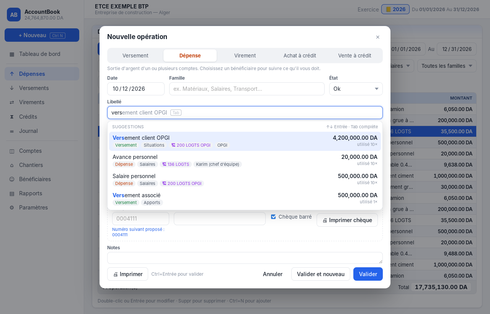
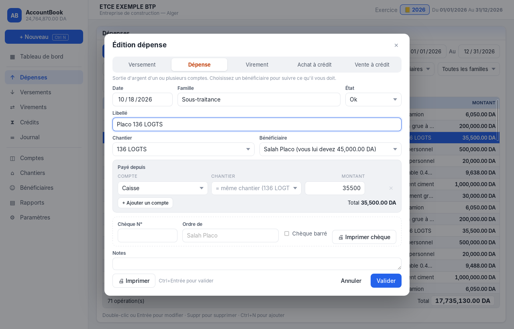
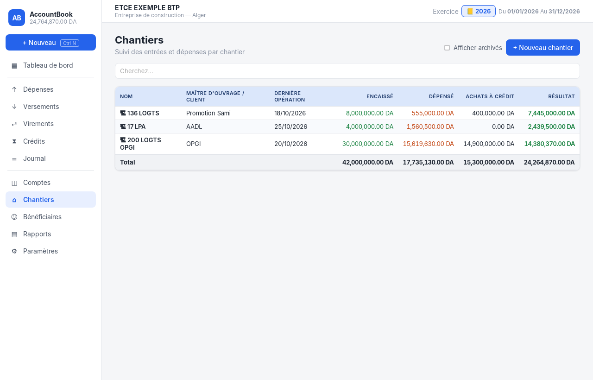
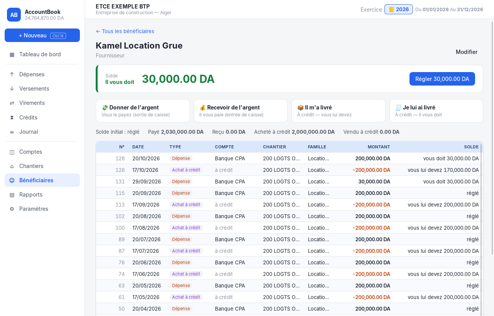
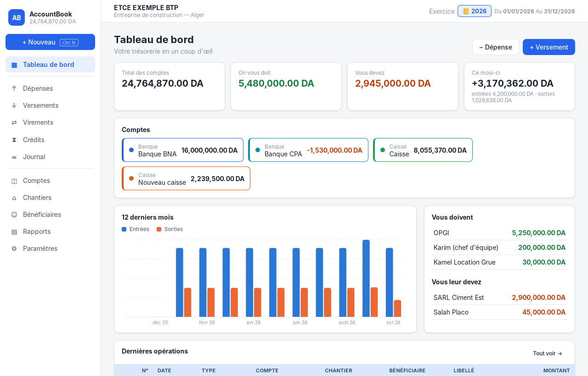

# AccountBook — gestion de trésorerie

A smart desktop treasury app for construction companies, built with **Tauri 2** (Rust + SQLite) and **React + TypeScript**.
It follows the workflow of classic treasury software (Dépenses / Versements windows, N° · Date · Compte · Chantier · Bénéficiaire · Libellé · Montant grid, fiscal years), and adds smart features on top.
The interface is in **French** by default, and English is available in Paramètres.


## Features

- **Journal windows** for Dépenses, Versements, Virements, Crédits and the full Journal:
  - a numbered grid with sortable columns and a total at the bottom
  - **Du / Au** dates and a search box ("Cherchez…") that also finds a N°, a cheque number or a chantier
  - filters by compte, chantier, bénéficiaire, famille and état
  - **Ajouter / Modifier / Supprimer / Imprimer**
  - keyboard: ↑↓, Enter to edit, Suppr to delete, Ctrl+N to add
- **Édition window** with Date, Famille, État, Libellé, Chantier, Bénéficiaire, Compte(s) and Montant, plus a **cheque section** (Chèque N°, Ordre de, Chèque barré, **Imprimer chèque**) and **Imprimer** for a voucher (*bon de dépense*) with the amount in words.
- **Deposits to several accounts.** One versement can be split over Caisse, Banque and so on. **Each line keeps the same chantier or gets its own.** Split tools: *Répartir également*, *Même montant partout*, *Total à répartir*.
- **Chantiers.** Money received and spent per site, credit purchases, the result, and a full statement.
- **Bénéficiaires.** Suppliers, clients and people, with **how much they owe you or you owe them**, a statement with running balance, and one-click *Régler*.
- **Smart labels that learn.** Suggestions while you type, ranked by:
  - text match, including typos and fuzzy matching
  - how often and how recently you used a label
  - the context: type, bénéficiaire and **chantier**

  Picking a suggestion fills in the type, famille, chantier, bénéficiaire, amount and the multi-account split. `Tab` accepts the grey completion.
- **Smart cheques.** The next cheque number of the account is suggested. The amount is written in words in French ("Huit mille deux cent quatre-vingt-huit dinars…"). Printing is calibrated with mm offsets and supports cheques fed vertically.
- **Fiscal years (exercices)** in the top bar, **reports** (by month, label, famille and chantier), a **calculator** in amount fields (`1200+350`), **Excel export** (`;`-separated, French decimals) and a **database backup**.

| Versement split across comptes and chantiers | Smart suggestions |
|---|---|
|  |  |

| Édition dépense | Chantiers |
|---|---|
|  |  |

| Bénéficiaire statement | Tableau de bord |
|---|---|
|  |  |

## Run it

Prerequisites: [Rust](https://rustup.rs), Node.js 20+, and the [Tauri prerequisites](https://v2.tauri.app/start/prerequisites/). On Windows 10/11 you only need the Microsoft C++ Build Tools, because WebView2 is already installed.

```bash
npm install
npm run tauri dev      # development window
npm run tauri build    # Windows installer in src-tauri/target/release/bundle/
```

Run the backend tests with `cd src-tauri && cargo test`.

Data is stored in one SQLite file, `%APPDATA%\com.accountbook.desktop\accountbook.db` on Windows. Database upgrades are automatic.

## How balances work

Amounts are stored as integer centimes.

| Type | Comptes | Bénéficiaire (+ = il vous doit) | Chantier result |
|---|---|---|---|
| Versement | + each account line | − | + received |
| Dépense | − each account line | + | − spent |
| Virement | − source, + destinations | — | — |
| Achat à crédit | no money moves | − (you owe them) | shown for information |
| Vente à crédit | no money moves | + (they owe you) | shown for information |

The chantier result is cash-based (received − spent). A credit purchase is paid later by a dépense, so subtracting both would count it twice.

## Project structure

```
src-tauri/src/
  lib.rs       Tauri commands (the API used by the UI)
  ledger.rs    SQLite schema + migrations, comptes, chantiers, bénéficiaires, opérations, reports, learning (+ tests)
  suggest.rs   Smart-label ranking: fuzzy/typo match, frecency, context (+ tests)
  models.rs    Shared data types
src/
  i18n.ts                          French / English texts
  words.ts                         Amounts in words (FR/EN)
  print.ts                         Voucher, cheque and list printing
  components/LabelInput.tsx        Smart label field
  components/TransactionForm.tsx   Édition window (multi-account, chantier per line, cheque)
  components/TransactionTable.tsx  Journal grid
  pages/                           Tableau de bord, Journal, Comptes, Chantiers, Bénéficiaires, Rapports, Paramètres
```
